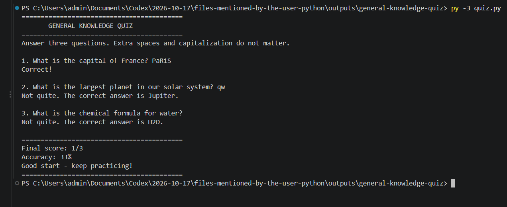

# General Knowledge Quiz

A beginner-friendly command-line quiz built with Python as Project 4 in the DecodeLabs Python Programming internship track.

The quiz asks three general knowledge questions, gives feedback after each answer, and reports a final score, accuracy, and short performance message.

## Features

- Three questions stored in one easy-to-edit collection
- A reusable function handles each question
- Answers are case-insensitive, and surrounding whitespace is ignored
- One point is added only when an answer is correct
- Final score, percentage accuracy, and feedback are shown at the end
- Uses only Python's standard library

## Requirements

- Python 3.8 or newer

## Run the quiz

Open a terminal in this folder and run:

```bash
python quiz.py
```

On Windows, you can also use:

```powershell
py -3 quiz.py
```

## Screenshots

### Quiz run

The screenshot shows mixed-case input being accepted and the final score after one correct answer.


## How it works

The program stores the questions, expected answers, and display answers in `QUESTIONS`. A `for` loop sends each one to `ask_question()`. That function reads input, applies `.strip().lower()`, and uses an `if`/`else` comparison to decide whether the response is correct. `main()` adds one point for each correct answer, and `show_results()` prints the final score and accuracy with f-strings.

## Project structure

```text
general-knowledge-quiz/
├── quiz.py       # Quiz logic and command-line interface
├── README.md     # Setup and project overview
└── .gitignore    # Common Python and editor-generated files
```

